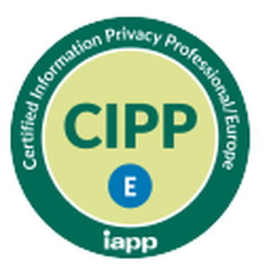
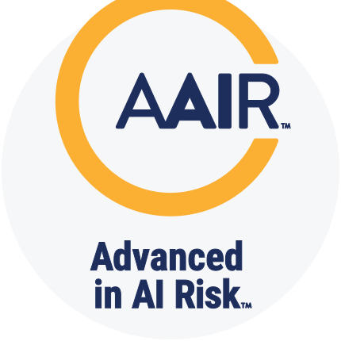
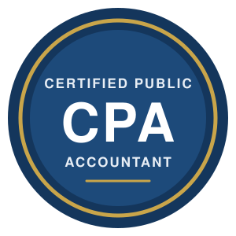

<h1 align="center">Joseph Hampton</h1>

<b>AI Assurance · AI Governance · Cloud Security</b>

  AI and data engineer focused on <b>responsible AI, assurance and governance</b>.
  Started as a <b>data analyst</b>, built web apps out of a hatred of PowerBI, moved into
  <b>DevOps and cloud</b> when people actually wanted to use them, and now build
  <b>agentic AI systems and the cloud they run on</b>.

  Building them taught me that trustworthy AI is a pipeline, and it breaks wherever nobody understands the next stage.
  <b>Governance and law</b> decide what an AI system is allowed to do and who answers for it.
  <b>Compliance and standards</b> turn that into controls that can be implemented, audited and proven.
  <b>Cloud and AI engineering</b> is where those controls either exist in the running system or don't.
  Lawyers who can't read an architecture, auditors who can't test a model, and engineers who've never read the regulation
  each see one third of the problem. I think you have to know all three to make AI that people can actually rely on,
  so that's what I'm training for, end to end.

  🎓 &nbsp;Working at an AI startup while doing an <b>MSc at Newcastle University</b> in Digital &amp; Technology Solutions.

<h3 align="center">Tech I work with</h3>

  

<h3 align="center">Certifications I'm studying for</h3>

<b>Governance and law</b> &nbsp;→&nbsp; <b>Compliance and standards</b> &nbsp;→&nbsp; <b>Cloud and AI implementation</b>

<h4 align="center">1. Governance and law</h4>

<i>What AI is allowed to do, under which laws, and who is accountable</i>

  
  &nbsp;&nbsp;
  
  &nbsp;&nbsp;
  

<h4 align="center">2. Compliance and standards</h4>

<i>Turning policy into management systems and controls that can be audited</i>

  
  &nbsp;&nbsp;
  
  &nbsp;&nbsp;
  
  &nbsp;&nbsp;
  
  &nbsp;&nbsp;
  

<h4 align="center">3. Cloud and AI implementation</h4>

<i>Building and securing the systems where those controls actually run</i>

  
  &nbsp;&nbsp;
  
  &nbsp;&nbsp;
  
  &nbsp;&nbsp;
  
  &nbsp;&nbsp;
  

  <a href="https://www.credly.com/users/joseph-hampton.480731e4">My Credly profile</a>

<h3 align="center">GitHub Activity</h3>

  

  

