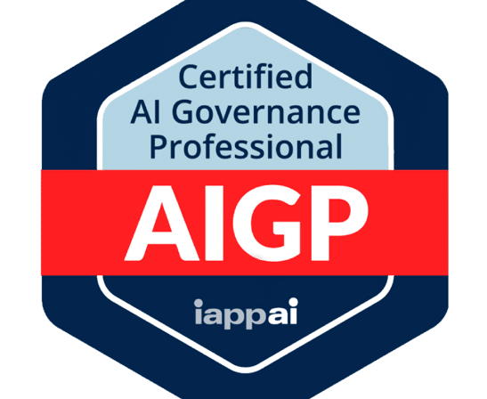
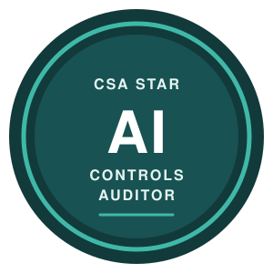

<h1 align="center">Joseph Hampton</h1>

<b>AI Assurance · AI Governance · Cloud Security</b>

  <b>My mission: translate AI law and standards into controls engineers can actually build.</b>

  Regulation without actionable steps is just a strongly worded PDF. I went from data analyst to web apps
  (out of a hatred of PowerBI) to DevOps, cloud and agentic AI, so I speak both languages,
  and I'm autistically into the bit in between.

  🎓 &nbsp;Working at an AI startup while doing an <b>MSc at Newcastle University</b> in Digital &amp; Technology Solutions.

<h3 align="center">Tech I work with</h3>

  

<h3 align="center">Certifications I'm studying for</h3>

<h4 align="center">1. Governance and law</h4>

  
  &nbsp;&nbsp;
  
  &nbsp;&nbsp;
  
  &nbsp;&nbsp;
  

<h4 align="center">2. Audit and assurance</h4>

  
  &nbsp;&nbsp;
  
  &nbsp;&nbsp;
  
  &nbsp;&nbsp;
  
  &nbsp;&nbsp;
  
  &nbsp;&nbsp;
  

<h4 align="center">3. Cloud and AI implementation</h4>

  
  &nbsp;&nbsp;
  
  &nbsp;&nbsp;
  
  &nbsp;&nbsp;
  
  &nbsp;&nbsp;
  

  <a href="https://www.credly.com/users/joseph-hampton.480731e4">My Credly profile</a>

<h3 align="center">GitHub Activity</h3>

  

  

