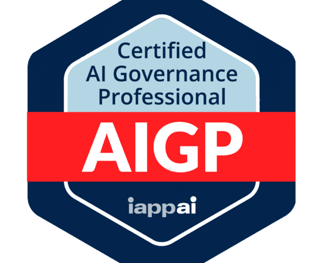
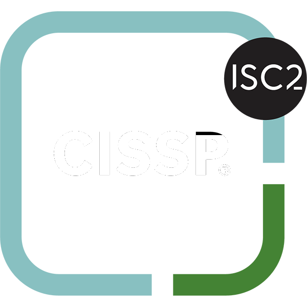

<h1 align="center">Joseph Hampton</h1>

<b>Security · AI Governance · Cloud</b>

  Software engineer going deep into <b>security, AI governance and cloud architecture</b>.
  Started as a <b>data analyst</b>, built web apps out of a hatred of PowerBI, moved into
  <b>DevOps and cloud</b> when people actually wanted to use them, and I'm now focused on
  <b>secure-by-default systems, AI risk &amp; compliance, and how we can govern and keep AI on firm guardrails</b>.

  🎓 &nbsp;Working at an AI startup while doing an <b>MSc at Newcastle University</b> in Digital &amp; Technology Solutions.

<h3 align="center">Tech I work with</h3>

  

<h3 align="center">Certifications I'm studying for</h3>

  
  &nbsp;&nbsp;
  
  &nbsp;&nbsp;
  
  &nbsp;&nbsp;
  
  &nbsp;&nbsp;
  

  
  &nbsp;&nbsp;
  
  &nbsp;&nbsp;
  
  &nbsp;&nbsp;
  

  
  &nbsp;&nbsp;
  
  &nbsp;&nbsp;
  

<h3 align="center">GitHub Activity</h3>

  

  

