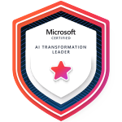
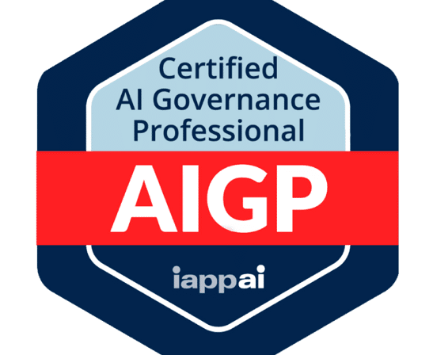

<h1 align="center">Joseph Hampton</h1>

<b>AI Assurance · AI Governance · Cloud Security</b>

  AI and data engineer moving into <b>AI assurance, governance and attestation</b>.
  Started as a <b>data analyst</b>, built web apps out of a hatred of PowerBI, moved into
  <b>DevOps and cloud</b> when people actually wanted to use them, and now build
  <b>agentic AI systems and the cloud they run on</b>. Next step: being the one who signs them off,
  with <b>SOC 2 and AIUC-1 assurance for AI agents</b>, on the way to becoming a <b>US CPA</b>.

  🎓 &nbsp;Working at an AI startup while doing an <b>MSc at Newcastle University</b> in Digital &amp; Technology Solutions.

<h3 align="center">Tech I work with</h3>

  

<h3 align="center">Certifications I'm studying for</h3>

<h4 align="center">Cloud and AI</h4>

  
  &nbsp;&nbsp;
  
  &nbsp;&nbsp;
  
  &nbsp;&nbsp;
  
  &nbsp;&nbsp;
  
  &nbsp;&nbsp;
  
  &nbsp;&nbsp;
  

<h4 align="center">Standards and compliance</h4>

  
  &nbsp;&nbsp;
  
  &nbsp;&nbsp;
  
  &nbsp;&nbsp;
  
  &nbsp;&nbsp;
  
  &nbsp;&nbsp;
  

<h4 align="center">Security and AI governance</h4>

  
  &nbsp;&nbsp;
  
  &nbsp;&nbsp;
  
  &nbsp;&nbsp;
  

<h4 align="center">Audit and assurance</h4>

  
  &nbsp;&nbsp;
  
  &nbsp;&nbsp;
  

  Working towards <b>US CPA licensure</b> (Washington State, ISC discipline) &nbsp;·&nbsp;
  <a href="https://www.credly.com/users/joseph-hampton.480731e4">My Credly profile</a>

<h3 align="center">GitHub Activity</h3>

  

  

